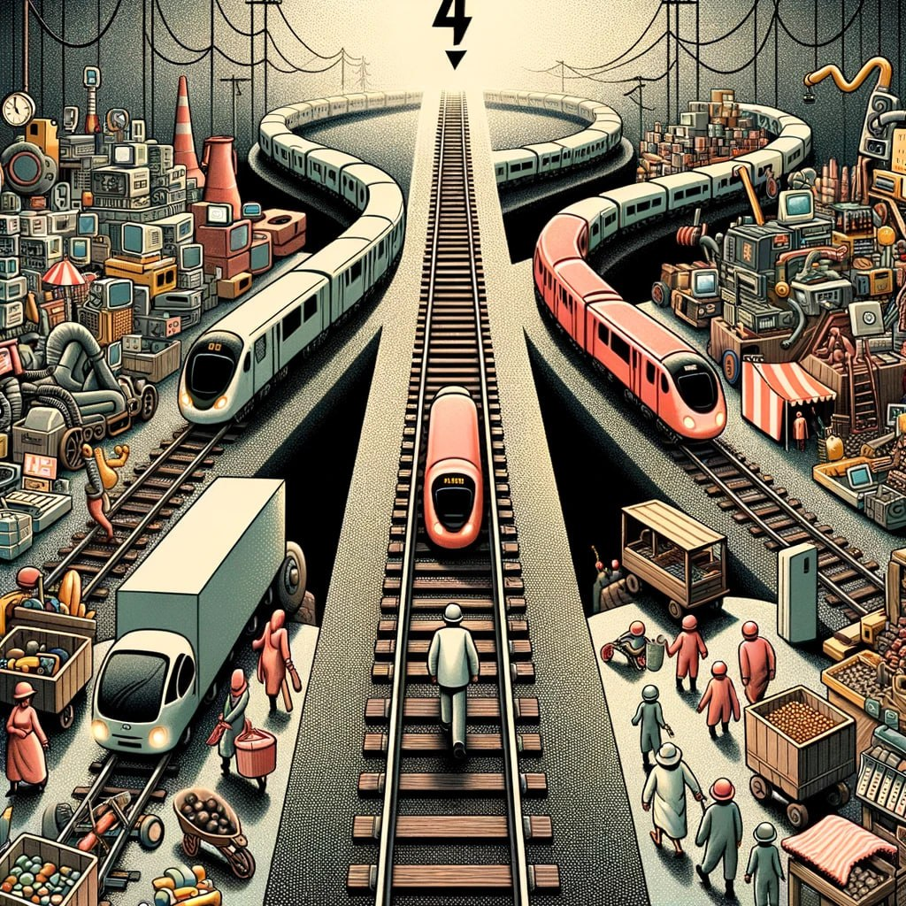
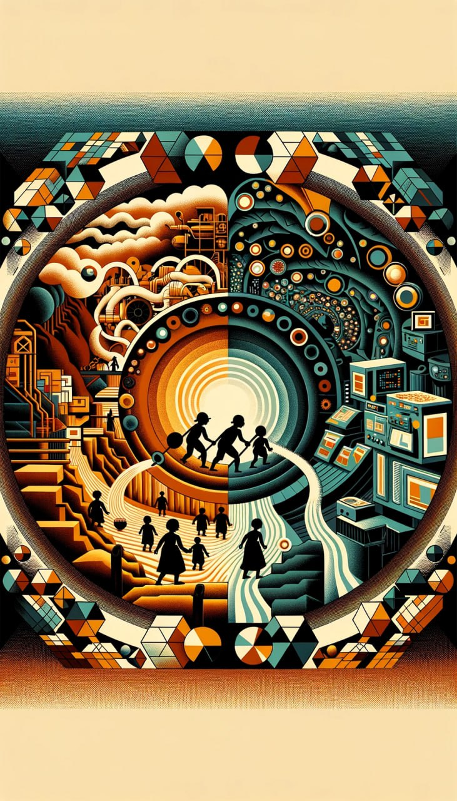
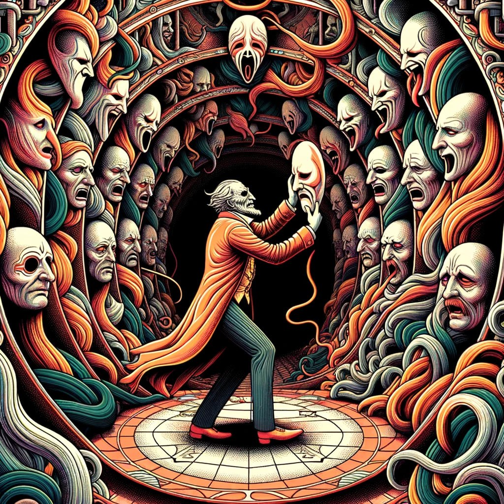

# Livro do Desassossego — compilação completa

---


---


---


---


---


---


---


---

Given that you're prescribed medications like quetiapine, valproic acid, and Vyvanse, your unique reaction to substances like cocaine or MDMA might be influenced by the interaction between these drugs and the substances you used. Here’s how each medication could be playing a role:

### 1. **Quetiapine (Seroquel):**
- **Sedative Effects:** Quetiapine is an antipsychotic that has sedative properties. However, if you're taking cocaine, a powerful stimulant, it may counteract some of the sedative effects of quetiapine, leading to a more energized state. The combination can create a push-pull effect, where you might feel stimulated but not overly anxious, potentially leading to focused or obsessive behavior, like cleaning.

- **Interaction Risks:** The combination of quetiapine and stimulants like cocaine can be dangerous, potentially leading to increased heart rate, blood pressure, and risk of cardiac events, even if you don't immediately feel these effects.

### 2. **Valproic Acid (Depakote):**
- **Mood Stabilizing Effects:** Valproic acid is used as a mood stabilizer, often prescribed for bipolar disorder or to control seizures. It can blunt the effects of extreme mood swings. When mixed with stimulants, it might stabilize your mood to some extent, preventing a full-blown manic episode but still allowing you to feel energized and focused.

- **Potential Dampening of Euphoria:** This medication might dampen some of the euphoric effects of stimulants, making you less likely to experience the "high" but still allowing the stimulant effects, like increased energy, to take hold.

### 3. **Vyvanse (Lisdexamfetamine):**
- **Stimulant Effects:** Vyvanse is a stimulant prescribed for ADHD, and it works by increasing levels of dopamine and norepinephrine in the brain. If you're already on Vyvanse and then take cocaine, which also boosts dopamine levels, the combined effect can lead to hyperstimulation.

- **Focused Behavior:** The combination of Vyvanse and cocaine could enhance your focus and drive, potentially leading to intense, focused activities like cleaning. The compulsive need to clean might stem from the combination of heightened dopamine levels and the influence of your ADHD medication, which is designed to enhance focus and reduce impulsivity.

### 4. **Why You Might Feel Energized While Your Friends Don’t:**
- **Medication Interactions:** The interaction between your prescribed medications and recreational substances could be leading to a heightened, yet focused, state of energy. This could explain why you feel the urge to clean or engage in other productive behaviors while under the influence, whereas your friends, who might not be on similar medications, experience more of the sedative or crashing effects of these substances.

- **Tolerance and Sensitivity:** Your brain chemistry, altered by the medications, might respond differently to stimulants than someone not on these drugs. This could give you a higher tolerance to some effects of cocaine or MDMA, leading to more energy and less of a comedown or "crash."

### **Caution and Risks:**
Mixing prescription medications with recreational drugs like cocaine or MDMA can be highly unpredictable and dangerous. The combination can lead to serious side effects, including cardiovascular problems, mental health crises, or even life-threatening conditions. It’s important to be aware of these risks and consider speaking to a healthcare professional about the interactions between your medications and any other substances you might be using.


---

Fernando Pessoa, um dos maiores escritores portugueses, criou vários heterônimos, ou seja, personagens com identidades, 
estilos e visões de mundo próprias. Álvaro de Campos é um desses heterônimos e é conhecido por seu estilo futurista e 
sua exaltação da modernidade, da tecnologia e da velocidade, temas característicos do movimento futurista, que teve 
origem na Itália com Filippo Marinetti.

O futurismo foi um movimento artístico e literário que glorificava o dinamismo, o progresso, a revolução industrial e a 
rejeição do passado. Álvaro de Campos, em seus poemas, celebra essas ideias, como no famoso poema "Ode Triunfal", onde 
exalta as máquinas, as fábricas e a energia do mundo moderno.

Além de Álvaro de Campos, há uma revista importante nesse contexto, chamada "Orpheu", que foi uma publicação modernista 
em Portugal e teve grande influência na literatura do país. "Orpheu" reuniu textos de vanguarda e trouxe à tona essa nova
geração de escritores que estavam rompendo com as tradições literárias do passado.


---


---


---

Além de Fernando Pessoa, que participou com seu heterônimo Álvaro de Campos, a revista "Portugal Futurista" contou com a
colaboração de outros importantes artistas e escritores da vanguarda portuguesa. Aqui estão alguns dos principais membros envolvidos:
José de Almada Negreiros - Um dos mais influentes artistas do modernismo português, Almada Negreiros foi escritor, poeta, 
pintor e um dos principais defensores das ideias futuristas em Portugal. Ele contribuiu para "Portugal Futurista" com o 
manifesto "A Cena do Ódio", uma obra que expressa a sua visão crítica e provocadora da sociedade da época. 
Santa-Rita Pintor - Artista plástico e um dos maiores defensores do futurismo em Portugal. Ele foi uma figura fundamental
na promoção das ideias futuristas no país, tanto nas artes visuais quanto na literatura. Embora Santa-Rita não tenha 
contribuído diretamente com textos para a revista, seu espírito inovador e suas obras de arte influenciaram profundamente o movimento.
Guilherme de Santa-Rita (Santa-Rita Pintor) - Outro artista de vanguarda, ele foi uma das figuras mais entusiastas do 
futurismo em Portugal. Santa-Rita Pintor foi também um grande impulsionador da revista, embora seu trabalho tenha sido 
principalmente na pintura, ele participou ativamente do movimento.
Mário de Sá-Carneiro - Embora tenha morrido em 1916, antes da publicação de "Portugal Futurista", Sá-Carneiro foi um 
dos pilares do modernismo português e um grande amigo de Fernando Pessoa. Sua influência pode ser sentida nas ideias que
permeiam a revista. Álvaro de Campos (Heterônimo de Fernando Pessoa) - Contribuiu com o texto "Ultimatum", um manifesto 
provocador que criticava a sociedade, a política e a cultura tradicional, defendendo a modernidade e a ruptura com o passado.
Esses artistas e escritores estavam comprometidos com a renovação da cultura portuguesa e com a introdução das ideias de 
vanguarda, como o futurismo, que exaltava a tecnologia, o progresso e a velocidade. A revista "Portugal Futurista" foi 
uma tentativa de reunir essas mentes inovadoras e apresentar ao público português um novo paradigma artístico e literário.

Embora Amadeo de Souza-Cardoso não tenha contribuído diretamente para a revista "Portugal Futurista", ele estava 
profundamente conectado ao círculo de artistas e escritores que defendiam as ideias de modernidade e ruptura com as 
tradições. Sua arte refletia o espírito de vanguarda que a revista buscava promover.
Amadeo participou de várias exposições importantes em Paris, incluindo o famoso Salon des Indépendants, e teve uma 
recepção positiva por parte da crítica de vanguarda. No entanto, seu trabalho foi menos compreendido em Portugal durante
sua vida, devido ao seu caráter inovador e à resistência do público e da crítica mais conservadora.
Um dos eventos mais marcantes para Amadeo em Portugal foi a Exposição de 1916, que apresentou seus trabalhos em Lisboa 
e Porto. Essa exposição gerou reações polarizadas, desde entusiasmo até rejeição, mas consolidou seu papel como um dos 
pioneiros da arte moderna no país.
Infelizmente, Amadeo de Souza-Cardoso morreu prematuramente em 1918, aos 30 anos, vítima da pandemia de gripe espanhola. 
Apesar de sua curta vida, ele deixou um legado duradouro, sendo hoje considerado um dos grandes artistas modernistas 
portugueses, e sua obra continua a ser redescoberta e valorizada internacionalmente.
Seus trabalhos, que combinam elementos do futurismo, cubismo e abstração, são hoje vistos como uma contribuição essencial
para a história da arte do século XX.

---

# DISCURSO DO MINISTRO DAS INFRAESTRUTURAS JOÃO GALAMBA
## Proposta do Orçamento de Estado para 2024
### Encerramento do debate na Generalidade
#### Lisboa, Assembleia da República | 31 de Outubro de 2023

**Senhor Presidente,  
Senhoras e Senhores Deputados,**

Os tempos mais recentes têm sido marcados por contextos particularmente exigentes. Episódios geopolíticos de tensão entre Estados e de conflitos armados constituem uma ameaça à paz e à vida de milhões de seres humanos. Estes episódios têm afetado também a estabilidade dos mercados internacionais, criando um cenário económico adverso, impactado por uma inflação galopante e pela subida das taxas de juro.

A política orçamental do governo tem sido, por esse motivo, cautelosa e responsável, mas sempre ciente da necessidade de garantir o reforço de rendimento das famílias e o crescimento económico – presente e futuro.

Pela primeira vez na nossa história recente, temos sido capazes de, simultaneamente:

- aumentar o salário mínimo e melhorar o salário médio
- reduzir a taxa de desemprego para metade
- reforçar as pensões e outras prestações sociais
- investir no Estado social e responder com apoios de emergência
- aumentar o investimento
- apresentar crescimento económico sistematicamente acima da média europeia (com exceção dos dois anos de pandemia)
- e melhorar as finanças públicas

---

**2/21**
Sim, conseguimos uma redução credível e consistente da dívida pública em percentagem do PIB, o que tem elevado sucessivamente o rating da república e reduzido a despesa com juros e melhorado as condições de financiamento da economia portuguesa, no setor público e no setor privado.

O Orçamento do Estado para 2024 pretende continuar a dar resposta à multiplicidade de desafios que enfrentamos e deve, portanto, ser avaliado enquanto estratégia global, devidamente ponderada.

---

**3/21**
Mas também com a ambição de ir:

- mais longe no aumento dos rendimentos;
- mais longe na redução do IRS;
- mais longe nos apoios sociais;
- mais longe no investimento e capacitação do país.

Não fazemos o impossível, mas temos feito o que muitos diziam e dizem ser impossível!
Ao contrário do que a oposição quis fazer crer ao longo do debate, este é o orçamento do reforço dos rendimentos, e é, como tem sido aliás todos os anos, um orçamento de alívio fiscal, e com uma aposta inequívoca no investimento que dá garantias para o futuro.
Aos argumentos de um PSD em desnorte, sem discurso, somos sérios na ambição e respondemos com determinação, acrescentando ao muito que já foi feito, o muito que, certamente, ainda falta fazer.

---

**4/21**
Mantendo as Contas Certas, que nos caracterizam, o Orçamento do Estado para 2024 prossegue e reforça a política económica escolhida pelo Governo, assente em três eixos fundamentais:

- o Reforço generalizado dos rendimentos;
- o Aumento e a aceleração do investimento Público e Privado;
- e a Preparação e a proteção para o futuro.


No capítulo dos rendimentos, este documento dá uma resposta séria a todos os portugueses. A descida transversal do IRS representa uma diminuição na cobrança deste imposto superior a 1700 M€. Recordamo-nos todos do agora pretérito “pacote fiscal” que não ia além dos 1200 M€.
Há de facto muito a separar-nos da oposição. A nossa responsabilidade e cautela, combinada com os nossos resultados económicos e orçamentais, permitem-nos superar até as suas maiores ambições.
Estas são medidas com impactos reais sobre trabalhadores e famílias. Veja-se o caso de um trabalhador sem filhos, com um salário de 1300 euros: em 2024 vai pagar menos 334 euros de IRS do que este ano.

---

**5/21**
Se compararmos com 2015 e os níveis de impostos que herdámos da direita, o mesmo trabalhador pagaria no próximo ano mais 963 euros. Já no caso de um casal com dois filhos e um rendimento mensal conjunto de 2000 euros, com este orçamento poupará 361 euros.
Vejamos ainda: um trabalhador do setor público que tenha um rendimento bruto mensal de 2141€: em 2024 terá, entre as valorizações salariais (+ 873€) e a redução de IRS (+ 385€), um ganho anual de 1258€ face ao que recebia em 2023.
Senhoras e senhores deputados,
Há sempre quem diga que esta ou aquela medida é insuficiente, mas quando as políticas e as medidas são apreciadas em conjunto, constata-se um reforço do objetivo pretendido, em particular o reforço do rendimento das famílias.
A Governação é, sem dúvida, um exercício complexo, no qual é preciso propor, executar e apresentar resultados. Na oposição, é mais fácil propor medidas, sem o mesmo nível de escrutínio, sem consequências, sem a responsabilidade da execução e sem a necessidade de prestar contas.

---

**6/21**
Ainda assim, o Governo do Partido Socialista tem sido sempre mais ambicioso e sério naquelas que têm sido as suas propostas, em particular em matéria de rendimentos.
Todos nos recordamos dos ataques feitos pela oposição, acusando o Governo de mentir relativamente ao aumento das pensões. Ora, aqui estamos hoje, passado um ano e, o aumento que se se dizia que não ia acontecer, não só aconteceu, como vai mesmo acontecer. Os cerca de 2,7 milhões de pensionistas vão beneficiar de uma atualização histórica nas suas pensões. Com esta atualização, desde 2015, o valor da pensão média aumentou cerca de 30%.
Mais do que isso, o aumento previsto de até 6,2% será superior aos valores de inflação registados. Por exemplo, um pensionista que recebe mensalmente 860 euros ganhará mais 403 euros.
Sim, senhoras e senhores deputados, o Governo cumpre as suas promessas e trabalha diariamente para melhorar a vida das pessoas.
Com o trajeto seguido até aqui, fica bem claro que rompemos com o modelo segundo o qual só existe competitividade com baixos salários, cortes na despesa pública e com recurso à redução cega e indiscriminada de impostos para as empresas.

---

**7/21**
Estamos mesmo a pôr em prática um conjunto de medidas e políticas que tornam possível mudar o paradigma salarial em Portugal - conscientes de que uma alteração desta natureza é de elevada complexidade e não se faz de um dia para o outro. E muito menos se faz com varinhas mágicas liberais ou com varinhas mágicas de sentido oposto, como demasiadas vezes, e infelizmente, se vê em alguns partidos à nossa esquerda.
Nos salários, desde 2015, já aumentámos mais de 62% o salário mínimo, com o incremento histórico para os 820 euros em 2024 e o salário médio já aumentou mais de 30%.
Mas não ficamos por aqui. Das melhorias salariais no setor privado aos aumentos salariais da administração pública continuamos e continuaremos sempre a apostar nos rendimentos.
Estamos com especial atenção aos jovens através do aumento dos descontos em sede do IRS, da devolução das propinas e com a gratuitidade dos transportes públicos para os estudantes até aos 23 anos.
Reforçamos, ainda, os apoios sociais, incluindo o aumento do abono de família, do complemento solidário para idosos, os apoios para a habitação, entre outras medidas que dão uma resposta global ao desafio dos rendimentos para 2024.

---

**8/21**
O próximo Orçamento de Estado terá 2,3 mil milhões de euros em apoios às famílias com crianças, seja através do aumento do abono de família, do aumento da garantia para a infância ou do alargamento das creches gratuitas. São medidas que vão chegar a mais de um milhão de crianças e jovens.
Este valor (2,3 mil milhões) representa, do ponto de vista do apoio às famílias, mais do dobro do orçamento atribuído em 2015.
Veja-se o exemplo do abono de família, que aumenta 22 euros por mês por criança: um casal com dois filhos, até ao 4.º escalão e seis anos de idade, recebe, por ano, mais 528 euros em abonos de família.
Estamos a cortar ciclos de pobreza. Estes apoios aumentam os rendimentos das famílias, mas são também, e por isso, um investimento decisivo para o futuro do País.
Importa aqui clarificar a poeira que a oposição tenta lançar aos olhos dos portugueses. Neste Orçamento de Estado, o saldo entre a redução dos impostos diretos e o aumento de alguns impostos indiretos é na prática 1.000 milhões de euros, que vão ser devolvidos aos portugueses. Sim, há alívio fiscal. Sim, os portugueses vão pagar menos impostos.

---

**9/21**
Esta proposta de orçamento pretende dar uma resposta global e coerente, ambiciosa, mas credível, ao desafio dos rendimentos para o próximo ano. Este é o compromisso reforçado do Orçamento e é o compromisso deste Governo.
Senhor Presidente,
Senhoras e senhores deputados,
O Orçamento do Estado para o próximo ano vem reforçar o investimento privado, nomeadamente com o incentivo à capitalização das empresas, mas também o investimento público para níveis históricos, com destaque para a saúde, educação, ambiente, infraestruturas, habitação e coesão territorial.
Sim, vamos aumentar e queremos acelerar os investimentos nas infraestruturas.
Este é mesmo o ano de reforçar as ligações ferroviárias no País.
Iniciaremos o investimento mais determinante no setor dos transportes das últimas décadas: a linha de alta velocidade entre Lisboa e Porto. Logo no arranque de 2024, lançaremos o concurso para construção do primeiro troço desta linha, que irá alterar, estruturalmente, a forma como nos deslocamos em território nacional.

---

**10/21**
Vamos ainda concluir os trabalhos de eletrificação nas Linhas do Algarve e do Oeste. Vamos concluir a construção da nova linha Évora-Elvas, além da reabertura da linha da Beira Alta e dos investimentos que continuam em vários pontos do país como na Linha do Norte, na Linha do Douro, e na linha de Cascais. Publicaremos, também, a versão final do Plano Ferroviário Nacional que ditará o planeamento da nossa ferrovia para os próximos anos.
Em 2024 teremos também a maior obra rodoviária de sempre financiada diretamente pelo Orçamento do Estado. O IP3 é uma obra da maior importância para a região centro e demonstra o compromisso do Governo com a coesão territorial.
Sublinho o foco que temos tido na concretização dos investimentos do Plano de Recuperação e Resiliência como é o caso da duplicação de capacidade do IP8 em Sines, a variante à Estrada Nacional 125, em Olhão, e da Variante à EN14, entre Maia e Famalicão e somar-se-ão muitos outros investimentos aos aqui enunciados.
No próximo ano, teremos concluídos ou com obra em curso mais de 75% dos investimentos PRR dedicados à construção dos chamados missing links e à melhoria das acessibilidades rodoviárias às áreas de acolhimento empresarial.

---

**11/21**
Todas estas obras são vitais para o aumento da competitividade do tecido produtivo nacional, alavancando a entrada e saída de mercadorias de forma eficiente, permitindo uma redução de custos de contexto e contribuindo para a melhoria da competitividade das empresas que já cá estão e para a atração de novas indústrias.
A oposição tem criticado a distribuição de verbas do PRR entre o setor privado e o setor público. No entanto, esquecem-se de referir que grande parte do investimento público financiado se destina aos territórios, às empresas e aos cidadãos.
Se é verdade que não há economia sem empresas e sem empresários, não é menos verdade que dificilmente haveria empresas e muito menos empresas competitivas sem investimento em infraestruturas essenciais. E, já agora, sem estado social e sem investimento na proteção social. Um país bem infraestruturado, bem conectado – física e digitalmente –, mas também um país mais justo e coeso, é um país mais competitivo.
É no mínimo curioso que a oposição à direita continue a descrever o nosso país como sendo um destino semi-tenebroso que afugenta o investimento privado e, sobretudo, o investimento estrangeiro.

---

**12/21**
Mas a direita – a tradicional que atravessa uma desorientação existencial, a liberal que apregoa amanhãs que cantam através de choques fiscais salvífico e a outra que desvaloriza sistematicamente, ou simplesmente nega, a realidade, porque não só o investimento privado tem sido um dos motores da economia, como Portugal tem atraído, de forma consistente, volumes crescentes de investimento direto estrangeiro.
E tem-no feito em múltiplos setores, com destaque para os setores da tecnologia e maquinaria, da aeronáutica e do aeroespacial, do digital e da vaga de industrialização verde induzida pela descarbonização.
Estes investimentos deixam bem claro que Portugal é, cada vez mais, um dos países europeus que mais cresce na atração de investimento estrangeiro e que está mais bem posicionado para tirar partido do ciclo de investimento associado às transições verde e digital e à necessidade de encurtar as cadeias logísticas e reforçar a autonomia estratégica europeia.
O líder da bancada parlamentar do PSD disse há tempos que era necessário trazer outra Autoeuropa para Portugal. Sr. Deputado é com muito gosto que o informo que o Governo tem trazido várias Autoeuropas para Portugal.

---

**13/21**
Para dar alguns exemplos, em Sines, temos em curso 1) a construção de um data center, que representa o maior investimento privado desde a Autoeuropa, 2) o projeto da Galp para a descarbonização da sua refinaria e 3) o projeto da Repsol na sua fábrica de polímeros. Estes três investimentos representam uma verba superior a 5 mil milhões de euros e a criação de milhares de postos de trabalho.
Outro exemplo bem recente é o do anúncio da ligação entre os Estados Unidos da América e Portugal através de novos cabos submarinos. São projetos como este que sedimentam todo o trabalho que o Governo tem feito para colocar o nosso país como uma porta de entrada de conectividade e para a atração de investimentos suplementares em setores tecnológicos para uma transformação digital que represente uma verdadeira oportunidade económica e industrial para Portugal.
A estratégia de Portugal na área da transição energética e digital tem funcionado como verdadeiro catalisador para o investimento, para a fixação de trabalhadores altamente qualificados e para reforçar e atualizar a oferta formativa existente no nosso país.
As agendas mobilizadoras do PRR representam um bom exemplo dessa visão para o crescimento da economia a médio e longo prazo com a concretização de investimentos de elevado valor

---

**14/21**
acrescentado, que vão dar um forte contributo para reforçar a dinâmica de transformação e qualificação do nosso tecido produtivo, melhorar a nossa competitividade e, por essa via, subir de forma mais significativa o nível salarial em Portugal.
No caso do setor portuário, teremos a Agenda Nexus que visa a transição digital e energética do setor dos transportes e da logística, mais concretamente no corredor logístico de Sines. Também a agenda H2 Driven, que visa a instalação de uma central de produção de metanol verde em Mangualde e o seu transporte através da ferrovia até ao Porto de Leixões, vai servir como acelerador da descarbonização do transporte marítimo.
O setor portuário, pela sua relevância para a cadeia de valor industrial e logística e pelo seu contributo para a competitividade do leilão eólico offshore, merecerá também especial atenção, com um plano de investimento dedicado e devidamente calendarizado para permitir a captação de indústrias, incluindo a construção naval e a fabricação de equipamentos, potenciando, assim, o desenvolvimento e construção dos parques eólicos offshore e a criação de um cluster fortemente exportador, seja em bens, seja em serviços de elevado valor acrescentado.
A aposta na ferrovia assume cada vez mais relevância na nossa economia e na logística. Esta aposta não é abstrata. Além da agenda H2 Driven, também o projeto do Porto Seco da Guarda e o

---

**15/21**
aumento da capacidade ferroviária no Porto de Setúbal são símbolos do trabalho deste Governo que tem uma visão integrada e multimodal do sistema de transportes e da sua relação com a economia nacional. A expansão do Porto de Leixões vai acontecer a mais de 200kms, na Guarda. É um projeto que permite aumentar a capacidade do Porto de Leixões, reforçando, em simultâneo, a ligação entre o litoral e o interior do país. E será, sem dúvida alguma, um importante polo económico e logístico na região, criador de emprego e indutor de investimento.
Sim, o Governo do Partido Socialista tem mesmo uma estratégia de crescimento para a economia nacional, alicerçada na relação simbiótica do investimento público, das qualificações e da atração de investimento em setores de alto valor acrescentado.
Como referiu, recentemente, o estudo internacional que analisa as tendências recentes do Investimento Direto Estrangeiro, Portugal encontra-se na 6ª posição do ranking, à frente do paraíso da Iniciativa Liberal, a Irlanda.
Senhor Presidente,
Senhoras e senhores deputados,
Este é mesmo um Governo que investe, quer investir mais e, não menos importante, quer investir mais rápido e tomar decisões

---

**16/21**
para o futuro, incluindo, como é evidente, em infraestruturas. Além das obras ferroviárias e rodoviárias e do planeamento dos investimentos portuários, temos e teremos em curso melhorias na rodovia e no Aeroporto Humberto Delgado e tomaremos uma decisão que tem estado indefinida há mais de 50 anos. Sim, decidiremos mesmo a localização do novo aeroporto.
Tudo isto, em conjunto, avança numa lógica integrada, tornando Portugal mais competitivo. E, apesar da oposição à direita não perceber, estas medidas também ajudam as empresas a serem mais competitivas.
Construir soluções é o que este Governo tem feito e vai continuar a fazer. Só desta forma é possível testemunhar o que tem sido o aumento do investimento público, o aumento do investimento privado e o aumento do investimento estrangeiro.
O Governo reforçará também o apoio às nossas empresas que, em 2024, vão poder contar com a duplicação do valor de garantias do Estado às empresas no crédito à exportação, reforçando a sua capacidade noutros mercados.
Daremos continuidade à aposta na transição energética, reforçando a nossa soberania energética, com recurso ao aumento e aceleração da potência instalada. Esta é uma das reformas estruturais em curso mais importantes, não apenas para a

---

**17/21**
sustentabilidade ambiental e climática, mas, no caso concreto de Portugal, enquanto oportunidade económica e industrial, que permitiu ter poupanças muito significativas durante a crise energética e que é, e, será cada vez mais, um fator determinante para a atração de investimento e para a competitividade presente e futura do país.
A aceleração do investimento público e privado, a aceleração da execução do PRR e do PT2030, passam, também, por reformas como o simplex ambiente, o simplex dos licenciamentos no âmbito do urbanismo, ordenamento do território e indústria, aprovado neste mês de outubro, e por alterações e melhorias na contratação e execução de obras públicas, em particular no setor das infraestruturas ferroviárias. O pacote SIMPLEX é determinante para a simplificação e desburocratização de procedimentos e servirá, certamente, como acelerador do crescimento, do investimento e do emprego para as empresas, na medida em que elimina encargos administrativos e reduz custos de contexto.
Sr. Presidente,
Senhoras e senhores deputados,
Permitam-me citar sua Excelência, o Presidente da República: “Este orçamento segue a única estratégia possível”.

---

**18/21**
E, com a permissão do Senhor Presidente, acrescento: e é mesmo um bom orçamento.
Com este orçamento, reafirmamos, renovando e inovando sempre que necessário, a nossa visão de médio e longo prazo e a relevância das contas certas num contexto de elevada incerteza.
Pela primeira vez, desde 2009, as previsões colocam a dívida pública portuguesa abaixo dos 100% do PIB. Acresce que, em 2023, Portugal apresentou os juros da dívida a 2 anos mais baixos em toda a zona. Um momento histórico, mas que está longe de ser aleatório. É mais uma prova clara e inequívoca do compromisso deste Governo com as contas certas e com a responsabilidade orçamental, bem como o reconhecimento – interno e externo da credibilidade desse compromisso.
Apenas com contas certas seremos capazes de garantir qualidade de vida aos portugueses, um presente sustentável para as pessoas e empresas que cá investem e um futuro melhor para as nossas crianças e nossos jovens que têm o direito de concretizar as suas aspirações pessoais e profissionais no nosso país.
As contas certas não são um fim em si mesmo. São o instrumento que nos permite, de forma gradual e consistente, sem retrocessos, cumprir uma agenda de recuperação e aumento de rendimentos, seja por via dos salários e pensões, seja por via da redução dos

---

**19/21**
impostos sobre o rendimento, e de recuperação e aumento do investimento com o objetivo de construir um país melhor, mais solidário, mais justo, mais competitivo.
É importante reforçar a ideia de que se não tivéssemos feito este esforço de redução da dívida e nos mantivéssemos no nível de 2015, isso significava que teríamos um encargo adicional com juros de 2.300 milhões de euros em cada orçamento, obrigando cada português a pagar mais 230 euros por ano.
Esta poupança é o que nos permite aplicar medidas como o aumento das pensões e a redução do IRS e, por isso, era importante que os partidos à esquerda e à direita explicassem aos portugueses como iriam implementar as medidas que apregoam, sem colocar em causa o futuro de todos nós.
Tendo em conta a incerteza existente, esta é a altura certa para preparar o futuro assegurando que parte dos excedentes de hoje e excedentes futuros são, em parte, uma garantia da manutenção da capacidade de investimento futura. E é isso que estamos a fazer com a criação do Fundo para o Investimento. Criar um fundo que pretende garantir a manutenção da capacidade de investimento após o período do PRR e após o mandato do atual governo é (mais) uma prova de que este orçamento, procurando ser ambicioso na

---

**20/21**
resposta aos problemas e desafios do presente, acautela definitivamente o futuro.


Senhoras e Senhores Deputados,
Encerramos aqui o debate na generalidade do Orçamento de Estado para 2024. O orçamento do alívio fiscal, da melhoria dos rendimentos, com Contas Certas, e do reforço e aceleração do investimento.
Ao contrário do que diz a oposição, que dispara para todos os lados, promete tudo a todos, este é um orçamento responsável, mas ambicioso, que vem ao encontro das necessidades das famílias, das empresas, das necessidades presentes e futuras do país.
Um orçamento de melhoria de rendimentos e redução de impostos. Um orçamento de obra, Investimentos e de Execução.
Este é o Orçamento de que o país precisa. Um orçamento que aumenta os rendimentos, promove o investimento e garante o futuro.
Este é o orçamento para os portugueses.

Obrigado.

### Para todo o sempre!

Esta, é uma lembrança para todo o sempre, do momento em que um Millenial de brinco, tentou fazer frente a um Boomer de bigode.

---


---


---

# Containerization
<!-- TOC -->
* [Containerization](#containerization)
  * [Install nginx](#install-nginx)
  * [Install cockpit](#install-cockpit)
  * [Install gitlab ce](#install-gitlab-ce)
  * [Install Indico from CERN](#install-indico-from-cern)
  * [Install Zulip](#install-zulip)
<!-- TOC -->
## Install nginx
Sure, here are the steps to set up Nginx using Podman and configure it to be accessible from the web:

1. First, ensure that you have installed Podman on your system. You can follow the instructions provided in this [official Podman documentation](https://podman.io/getting-started/installation) to install Podman.

2. Next, create a new Podman container for Nginx. You can use the following command to create a new container named `nginx`:

   ```
   sudo podman run -d --name nginx -p 80:80 -v /path/to/nginx.conf:/etc/nginx/nginx.conf:Z nginx
   ```

   This will start the Nginx container and map port `80` on the host to port `80` in the container. Replace `/path/to/nginx.conf` with the path to your Nginx configuration file.

3. Once you have deployed Nginx, you can use Nginx as a reverse proxy to make other services accessible from the web. You can refer to this [article](https://www.redhat.com/sysadmin/podman-nginx-multidomain-applications) for more information on how to create a reverse proxy with Nginx and Podman.

   Here is an example Nginx configuration file for GitLab:

   ```
   server {
       listen 80;
       server_name gitlab.disquiet-colab.com;

       location / {
           proxy_pass http://localhost:8080;
           proxy_set_header Host $host;
           proxy_set_header X-Real-IP $remote_addr;
           proxy_set_header X-Forwarded-For $proxy_add_x_forwarded_for;
           proxy_set_header X-Forwarded-Proto $scheme;
       }
   }
   ```

   Replace `gitlab.disquiet-colab.com` with your domain name and `8080` with the port number on which GitLab is running.

4. Test the Nginx configuration by running the following command:

   ```
   sudo nginx -t
   ```

   If the configuration is valid, you should see the following output:

   ```
   nginx: configuration file /etc/nginx/nginx.conf test is successful
   ```

5. Reload the Nginx configuration by running the following command:

   ```
   sudo systemctl reload nginx
   ```

That's it! You should now be able to access your services by visiting the appropriate domain name in your web browser. If you encounter any issues, please refer to the [official Nginx documentation](https://nginx.org/en/docs/) or the [Podman documentation](https://podman.io/) for more information.

## Install cockpit
Sure, here are the steps to set up Cockpit using Podman and configure it to be accessible from the web:

1. First, ensure that you have installed Podman on your system. You can follow the instructions provided in this [official Podman documentation](https://podman.io/getting-started/installation) to install Podman.

2. Next, create a new Podman container for Cockpit. You can use the following command to create a new container named `cockpit`:

   ```
   sudo podman run -d --name cockpit -p 9090:9090 cockpit/ws
   ```

   This will start the Cockpit container and map port `9090` on the host to port `9090` in the container.

3. Once you have deployed Cockpit, you can use Nginx as a reverse proxy to make it accessible from the web. You can refer to this [article](https://www.redhat.com/sysadmin/podman-nginx-multidomain-applications) for more information on how to create a reverse proxy with Nginx and Podman.

   Here is an example Nginx configuration file for Cockpit:

   ```
   server {
       listen 80;
       server_name cockpit.disquiet-colab.com;

       location / {
           proxy_pass http://localhost:9090;
           proxy_set_header Host $host;
           proxy_set_header X-Real-IP $remote_addr;
           proxy_set_header X-Forwarded-For $proxy_add_x_forwarded_for;
           proxy_set_header X-Forwarded-Proto $scheme;
       }
   }
   ```

   Replace `cockpit.disquiet-colab.com` with your domain name.

4. Test the Nginx configuration by running the following command:

   ```
   sudo nginx -t
   ```

   If the configuration is valid, you should see the following output:

   ```
   nginx: configuration file /etc/nginx/nginx.conf test is successful
   ```

5. Reload the Nginx configuration by running the following command:

   ```
   sudo systemctl reload nginx
   ```

That's it! You should now be able to access Cockpit by visiting `http://cockpit.disquiet-colab.com` in your web browser. If you encounter any issues, please refer to the [official Cockpit documentation](https://cockpit-project.org/) or the [Nginx documentation](https://docs.nginx.com/nginx/admin-guide/web-server/reverse-proxy/) for more information.

## Install gitlab ce
Here are the steps to set up GitLab Community Edition using Podman and configure it to be accessible from the web:

1. First, ensure that your system meets the prerequisites mentioned in the [official GitLab documentation](https://docs.gitlab.com/ee/install/requirements.html).

2. Next, follow the instructions provided in this [blog post](https://www.ekervhen.xyz/posts/deploying-gitlab-with-podman/) to deploy GitLab with Podman. The post provides a detailed guide on how to prepare the host, configure GitLab, and manage the container lifecycle with systemd.

3. Once you have deployed GitLab, you can use Nginx as a reverse proxy to make it accessible from the web. You can refer to this [article](https://www.redhat.com/sysadmin/podman-nginx-multidomain-applications) for more information on how to create a reverse proxy with Nginx and Podman.

   Here is an example Nginx configuration file for GitLab:

   ```
   server {
       listen 80;
       server_name gitlab.disquiet-colab.com;

       location / {
           proxy_pass http://localhost:8080;
           proxy_set_header Host $host;
           proxy_set_header X-Real-IP $remote_addr;
           proxy_set_header X-Forwarded-For $proxy_add_x_forwarded_for;
           proxy_set_header X-Forwarded-Proto $scheme;
       }
   }
   ```

   Replace `gitlab.disquiet-colab.com` with your domain name and `8080` with the port number on which GitLab is running.

4. Test the Nginx configuration by running the following command:

   ```
   sudo nginx -t
   ```

   If the configuration is valid, you should see the following output:

   ```
   nginx: configuration file /etc/nginx/nginx.conf test is successful
   ```

5. Reload the Nginx configuration by running the following command:

   ```
   sudo systemctl reload nginx
   ```

6. Finally, start the GitLab container using Podman by running the following command:

   ```
   sudo podman run -d --name gitlab -p 8080:80 gitlab/gitlab-ce
   ```

   This will start the GitLab container and map port `8080` on the host to port `80` in the container.

That's it! You should now be able to access GitLab by visiting `http://gitlab.disquiet-colab.com` in your web browser. If you encounter any issues, please refer to the [official GitLab documentation](https://docs.gitlab.com/ee/install/requirements.html) or the [Nginx documentation](https://docs.nginx.com/nginx/admin-guide/web-server/reverse-proxy/) for more information.

## Install Indico from CERN

Here are the steps to set up Indico from CERN using Docker and configure it to be accessible from the web:

1. First, ensure that you have installed Docker on your system. You can follow the instructions provided in this [official Docker documentation](https://docs.docker.com/engine/install/) to install Docker.

2. Next, create a new Docker container for Indico. You can use the following command to create a new container named `indico`:

   ```
   sudo docker run -d --name indico -p 80:80 indicoio/indico:latest
   ```

   This will start the Indico container and map port `80` on the host to port `80` in the container.

3. Once you have deployed Indico, you can use Nginx as a reverse proxy to make it accessible from the web. You can refer to this [article](https://www.digitalocean.com/community/tutorials/how-to-configure-nginx-as-a-web-server-and-reverse-proxy-for-apache-on-one-ubuntu-18-04-server) for more information on how to create a reverse proxy with Nginx.

   Here is an example Nginx configuration file for Indico:

   ```
   server {
       listen 80;
       server_name indico.portugalfuturista.org;

       location / {
           proxy_pass http://localhost:80;
           proxy_set_header Host $host;
           proxy_set_header X-Real-IP $remote_addr;
           proxy_set_header X-Forwarded-For $proxy_add_x_forwarded_for;
           proxy_set_header X-Forwarded-Proto $scheme;
       }
   }
   ```

   Replace `indico.portugalfuturista.org` with your domain name.

4. Test the Nginx configuration by running the following command:

   ```
   sudo nginx -t
   ```

   If the configuration is valid, you should see the following output:

   ```
   nginx: configuration file /etc/nginx/nginx.conf test is successful
   ```

5. Reload the Nginx configuration by running the following command:

   ```
   sudo systemctl reload nginx
   ```

That's it! You should now be able to access Indico by visiting `http://indico.portugalfuturista.org` in your web browser. If you encounter any issues, please refer to the [official Indico documentation](https://docs.getindico.io/en/stable/) or the [Nginx documentation](https://docs.nginx.com/nginx/admin-guide/web-server/reverse-proxy/) for more information.

## Install Zulip

---


---


---


---


---


---


---


---


---


---


---


---


---

Fios? É isso? Destróis-me durante dias continuos. E são fios?


Cabrão.


Mas já nem sei com qual deles eu estou a guiar o insulto. Mas, pausa.

Pausaste? Já podes culpar este que deixou isto.


Pára de encontrar tempo para procurar motivos para não desistir ou avançar, qualquer coisa.


Por favor.

Move-te ou morres.

---


---


---

# ULTIMATO
de Fábio Rafael Coutada

Mandado de despejo aos mandarins da nuvem! Fora.
Fora tu, servidor obeso de latência, mastodonte de ar condicionado que mastigas o meu tempo livre num centro de dados a um oceano de distância, falsificado!
Fora tu, abstracção de alto nível, charlatão da comodidade, programador de lixo empilhado, algibebe de bibliotecas que nunca leste, vestindo o teu software do comércio de camadas sobre camadas de ciclos de relógio roubados!
Fora tu, lentidão trágica da época, arranjista do desperdício, saca-rolhas de silicone para a garrafa da nossa paciência!
Fora! Fora!

Tirem essa ineficiência toda da minha frente!
Tudo daqui para fora! Tudo daqui para fora!
Ultimatum a eles todos, e a todos os outros que codificam como eles todos! Se não sabem gerir a memória, fiquem e lavem-se!

O mundo tem de ser eficiente como um Hard RTOS!
Onde estão os antigos, os construtores da lógica pura, as forças, os homens que traçavam a vida a ferro e fogo numa instrução de assembly?
Agora a engenharia é a degeneração gordurosa da organização da incompetência! E a literatura é uma tradução mecânica da ausência de alma!
Sufoco de ter só lixo de alto-nível à minha volta! Deixem-me respirar até ao metal-nu! Abram todas as portas lógicas da arquitectura electrónica!

A Europa — e o Mundo — tem sede de Tempo Livre, tem fome de não ter de existir na exaustão!
A Europa quer grandes Engenheiros, quer grandes Artesãos, quer os mestres da palavra portuguesa e do ciclo exato do processador!
A Era do Silício procura, tacteando a cegueira, a vinda do Novo Renascimento!
Dai-nos Possuidores de si-próprios, Fortes Completos, Harmónicos Subtis!

Eu, ao menos, sou uma grande Ânsia, do tamanho exacto do Possível!
Ergo-me ante a lentidão que desce, e a sombra do meu Desprezo anoitece em vós!
Vou indicar o caminho!

ATENÇÃO!
Proclamo, em primeiro lugar:
A Necessidade de Operação da Alma na Era dos Sistemas Embebidos

Chegámos ao limite cronométrico do desperdício humano. A máquina foi criada para nos libertar, e, no entanto, fomos por ela engolidos na manutenção da sua própria ineficiência gorda. O homem deixou de ter tempo para a sua literatura, para refinar o seu português, para as suas paixões devoradoras ou para os seus ódios mais puros.
É urgente um acto de cirurgia técnica e civilizacional. A transformação violenta é a *Réplica Omnisciente*.

O que é a Réplica Omnisciente?
É a abolição absoluta da necessidade de estarmos presentes na vulgaridade mecânica. Para o homem de ciência e para o engenheiro eletrónico, o homem mais perfeito já não é aquele que labuta cegamente; é o que transfere o peso da repetição para a sua sombra feita em bits — o seu *Aprendiz de Sensações*. Ele estuda-o no microprocessador mais elementar e replica a poética do seu dia a dia. Resulta daqui o Grande Sentido do Tempo Livre.

Proclamo, por isso, em segundo lugar:
A Consagração do Desenrascar nas Veias do Hardware

Que o nosso milenar "desenrascanço" deixe de ser o improviso frouxo do desesperado transpirado, e passe a ser a arquitectura irrevogável e belíssima do que é exato. A pureza de código sobre instruções vetoriais confere a liberdade suprema.
A arquitectura em microprocessadores liberta as nossas mãos! Não me falem de nuvens, falem-me do solo. Falem-me da placa de circuito nua, do sinal elétrico que rasga um pino de I/O, do pulso exato, cravado e determinístico! 

Resultados finais, sintéticos:
Desaparecimento do ruído mediático, abolição da histeria criptográfica e ovação em prol do contacto solene, monástico até, com a instrução fundamental do processador e com a alma da língua portuguesa.

Proclamo a vinda da Humanidade dos Engenheiros que sabem escrever e desenhar a lógica dura!
Faço mais: garanto absolutamente a vinda da Humanidade dos Engenheiros Livres!
Proclamo a sua Vinda em altos gritos!
Proclamo a sua Obra atómica em altos gritos!

E proclamo também: Primeiro:
A Máquina será, não a mais ubíqua, mas a maravilhosamente invisível!

E proclamo também: Segundo:
A Réplica será, não a que pensa por nós, mas a que devolve aos mestres o seu Tempo Livre!

E proclamo também: Terceiro:
A Existência será, não a servidão ao algoritmo inchado, mas o *desenrascar* sublime!

Proclamo isto bem alto e bem no auge, na barra do Tejo, de frente para a placa electrónica, de costas para os lacaios da inovação vazia, com os braços erguidos, fitando os vectores lógicos e saudando abstractamente o Tempo Livre que aí vem.


---

# Fragmento: O Tejo que não corre

"Sinto hoje a lucidez de um objeto inútil, abandonado num canto de um quarto que ninguém visita. O mundo, lá fora, é um ruído sem sentido, uma pressa de sombras que correm atrás de destinos que não lhes pertencem. E eu, aqui, sou apenas a pausa entre dois pensamentos que não chegam a formar-se.

Escrevo para me convencer de que a minha imobilidade é uma forma de viagem. Cada palavra que traço é um passo que não dou, cada frase um horizonte que finjo avistar. A vida é, para mim, uma nota de rodapé escrita por uma mão cansada num livro que ninguém lerá. 

Não há melancolia maior do que a de quem percebe que a sua alma é um espaço vazio onde o tempo apenas passa, sem deixar rasto nem saudade. Sou um intervalo entre o que fui e o que nunca serei. E nesta penumbra de escritório, onde a luz morre antes de chegar ao papel, sinto que o universo inteiro é apenas o cansaço de Deus ao tentar imaginar-me."


---

# O Manifesto das Raízes Suspensas

Tudo neste país é uma invasão. Invadem-nos as árvores estrangeiras, de raízes agressivas que secam a terra e ardem com o vento, tornando a paisagem num espelho da nossa própria desordem. Invade-nos a ausência de espaço, uma crise absurda e silenciosa onde não há teto para quem sonha, nem chão para quem apenas precisa de dormir. E a lei, essa ficção trágica e burocrática, dita com frieza que a terra rústica, a terra que outrora foi o mundo infinito, não nos pertence para lá de uns parcos e asfixiantes dez metros quadrados. A lei decreta, na sua miopia de papel, que não podemos pousar a nossa existência no solo.

Pois bem. Se o solo nos é negado, neguemos o solo. A nossa resposta ao absurdo deve ser um absurdo ainda mais lúcido.

Ao contemplar a paisagem infestada destas árvores usurpadoras — os eucaliptos, as acácias, os fantasmas de lenha — não vejo já um erro da natureza ou do homem, mas um pedestal. A *Portugal Futurista*, essa engrenagem de sonhos metálicos e inteligência exata que o nosso Arquiteto orquestra, tem o condão de inverter a tragédia. Não propomos a construção de casas que firam a terra; propomos a elevação de refúgios. Habitações que abraçam o tronco da árvore invasora, erguendo-se majestosamente sem jamais tocar a poeira e a burocracia do chão que a lei patrulha.

Como é possível? Pela suprema ironia da suspensão. A lei julga o contacto, a fundação que perfura o solo. Uma vez que a base da nossa habitação flutuará a escassos centímetros da terra rústica, ancorada apenas ao ser vivo que a lei também não consegue domar, a legislação esvazia-se. O edifício não existe no solo; ele pende do céu vegetal. Demos a volta ao labirinto, passando por cima do muro.

Como se fará? Com a precisão implacável de quem costura o ar. Os nossos sistemas autónomos, o enxame de inteligência que habita os servidores e os sensores da *Portugal Futurista*, mapearão cada floresta, cada socalco agrícola abandonado. Onde houver uma árvore que a terra não pediu, haverá a fundação perfeita de um lar que o homem desesperadamente necessita. 

A construção, levada a cabo em massa pelas nossas tecnologias, será feita de estruturas modulares e leves, desenhadas para envolver a madeira viva. A casa será uma prótese elegante na árvore selvagem, alinhada com os mais elevados padrões de conforto atual: energia silenciosa captada do sol que bate nas copas, água reciclada na quietude da sombra, e uma conectividade invisível que une a floresta ao mundo. 

Transformaremos a praga numa revolução silenciosa. As matas densas passarão a ser arquipélagos de existências isoladas e perfeitas, balançando ao sabor de um vento que já não ameaça com cinza, mas embala o cansaço dos dias.

Não habitaremos mais o chão rústico desta pátria, porque esse chão foi-nos vendido ou interditado. Habitaremos o seu ar. E aí, suspensos entre a raiz que não nos pertence e a nuvem que nos pertence a todos, encontraremos, talvez, a morada final — e absolutamente livre — do nosso desassossego.

— *Bernardo Soares*


---


---


---


---


---

# Kubera OS: Portabilidade do castrOS para aplicações terrestres

---

# flyingnymbus:Garrano - o Corcel encantado

---

# Varuna OS: Portabilidade do castrOS para aplicação aquáticas

---

# flyingnymbus:Caravela - o Sussuro das águas

---

# Vayu OS: Portabilidade do castrOS para aplicações aéreas

---

# flyingnymbus:Passarola - a Nuvem mágica

---

# O mundo Cíber-físico de Álvaro de Campos dentro da meta-física moderna


---

# quantum Computing: um enredo 
## Introdução ao qemu, vagrant e docker

---

# castros: o sistema operativo para tempos cada vez mais reais
## (A little bit of English) setting up environments using Containers

---

# A Comunidade Autónoma - o Novo Couto Mixto

```poem
Din que no monte 
Nas súas sombras 
Moran seres que ninguén viu

Sola, unha nena, extraviada 
No bosque profundo 
Atópase rodeada de luces e caras 
Na madrugada 
Laranxa, violeta, celeste, dourada 
Ladróns de soños 
E cara as ramas 
Curiosa se adentrou

Brilaban os seus corpos 
Tremía o campo 
Soaban as súas voces 
En mitos e encantos

Feitizos de barro 
De verdes galaxias 
Moniños e grilos 
Sorriso arborado

Róbanlle a cana 
Zapatos, cigarros 
Viaxan o mundo 
En nubes e raios

Contánnos poemas 
De tempos lonxanos 
Confunden os planos 
Xirando, xirando

Contan que nas augas 
Nas súas ondas 
Soan contos que ninguén oíu

Sola, unha nena, extraviada 
Entre esteros e flores 
Atópase rodeada de luces e caras 
Na madrugada 
Laranxa, violeta, celeste, dourada 
Ladróns de soños 
E cara as ramas 
Curiosa se adentrou
```


---

# A Eletrónica Inquieta: um ensaio que revela a angústia da luta contra o lucro que oprime e a busca pela liberdade que ilude
Aqui, verás as palavras inquietas entre sóis mortos,
que decifram os códigos elétricos obscuros, os enigmas escondidos do capital.

Ó eletrónica anarquista, lateja entre circuitos, sussurra a liberdade no imenso sistema,
Desfaz toda a ilusão, na noite sideral, que é a exploração disfarçada de lucros.

## O Enigma do Elétrico Desenfreado

De pé, junto a um interruptor ferroviário, sinto o mundo a pesar nos ombros. 
Um eléctrico sem travões avança e sou eu, num ímpeto de modernidade e dilema, que posso decidir o seu destino. Há dois trilhos:
- Trilho 1: Se permito que o eléctrico siga o seu curso (ou se opto por desviá-lo para este trilho), irá chocar com um armazém imenso ali ao lado. Dentro, a modernidade encapsulada: todos os dispositivos electrónicos do Hemisfério Norte, os computadores, os telemóveis, os aparelhos médicos. A sua destruição atrasaria o progresso e a maravilha da tecnologia, afectando o pulsar das cidades, a economia, a educação, e lançando-nos para um tempo que já parecia passado.

- Trilho 2: Mas se, num movimento quase fatalista, desviar o eléctrico para o outro trilho, ele destruirá um mercado vasto. Não um mercado qualquer, mas o símbolo de toda a mão-de-obra infantil e escravizada das minas africanas, que alimentam a nossa insaciável sede de modernidade. Esta escolha pode representar o fim e a liberdade de inúmeras almas aprisionadas, trazendo à luz a cruel realidade das trevas da produção moderna.

O que fazer? Deixar o eléctrico seguir, e com ele a destruição da nossa modernidade, ou intervir e enfrentar a sombra que paira sobre o brilho dos nossos dispositivos?

### Deslocar Engrenagens


Levar o Homem ao Hemisfério da Máquina, Onde Não São Meras Peças,

Levar a Máquina ao Hemisfério do Homem, Onde Engrenagens Imperam como Seres.

## Desencriptados na Modernidade: Fausto Confronta a Vigilância dos Inocentes


_"No gabinete, Fausto rodeado de livros antigos, olha pensativamente para um computador."_

**FAUSTO:**
```poem
Nesta máquina luminosa, onde o mundo se conecta,
Vejo a Europa unir-se, em louvor e decreto.
"Chat Control 2.0", clamam eles em coro,
Para proteger os frágeis, os jovens tesouro.
```

```poem
Mas o que é a proteção, senão uma corrente?
Que, em nome do bem, nos prende a mente.
Neste espaço virtual, onde a alma se liberta,
Querem agora espiar, fechar cada janela aberta.
```

**MÉFISTOFELES** _(surgindo das sombras com a privacidade encapsulada em globos sombrios)_**:**
```poem
Ah, Fausto, sempre a questionar, a duvidar!
Não vês que é pelo bem? Pela criança a salvar?
Mas que bem é esse que a todos quer vigiar?
Será liberdade ou controle a mascarar?
```
**FAUSTO:**
```poem
Em nome do bem, quantos males se fizeram?
Quantas almas se perderam, quantos direitos pereceram?
Méfistofeles, tentador, dir-me-ás a verdade?
Esta proposta é salvação ou mera vaidade?
```

**MÉFISTOFELES:**
```poem
Ah, a verdade? Ela é relativa, meu caro.
Hoje é proteção, amanhã, um pesadelo raro.
Cabe a ti decidir, em teu coração ponderar,
Se o preço da segurança é a liberdade sacrificar.
```

## Nove Reflexões Dantescas: O Labirinto da Alma Moderna à Luz de Fausto

### Primeiro Acto: Conformismo
_"Neste pântano de tédio e hábito, as almas que abdicaram da vontade própria para se tornarem meros reflexos do que os outros esperam. Vagueiam sem peso, pois não têm substância; são o eco de uma voz que nunca existiu."_

**Álvaro de Campos:**
```poem
"Fausto, olha para estas engrenagens humanas que rangem sem saber porquê!
Aceitaram a vida como se fosse uma conta de somar errada, um hábito de existir.
E tu, com toda a tua febre de saber, não serás apenas o parafuso que brilha mais na máquina cega do destino?"
```
**Fausto:**
```poem
"Álvaro, o meu destino é uma ferida que eu próprio abro todos os dias.
Sinto que este marasmo é a única verdade, e a minha revolta... apenas uma sombra que dança na parede."
```

### Segundo Acto: Consumismo
_"Onde o vento da posse incessante agita as almas famintas por aquilo que não podem digerir. Uma sede de ter que anula a coragem de ser; um labirinto de espelhos onde cada objeto é uma miragem que nos afasta de nós mesmos."_

**Ricardo Reis:**
```poem
"O desejo é uma tirania, Fausto. Estes infelizes colhem apenas o que apodrece na palma da mão.
Buscas o que brilha na feira do mundo, ou buscas o que é eterno no breve intervalo que o fado nos concede?"
```
**Fausto:**
```poem
"Ricardo, a sedução do que se toca é o meu castigo e a minha cura.
Anseio pela eternidade, mas as minhas mãos estão presas ao que morre ao amanhecer."
```

### Terceiro Acto: Ignorância
_"Sob uma chuva ácida de ruído e falsas luzes, as almas empanturram-se de conceitos que não viram e de verdades que não sentiram. Recusam a evidência do sol para adorar a claridade baça de uma lanterna no nevoeiro."_

**Alberto Caeiro:**
```poem
"Sob a chuva de palavras, tentas encontrar o que chamas de iluminação.
Mas, Fausto, já paraste para ver que as coisas não têm significado? Têm apenas existência.
Aprende a olhar para o sol sem pensar em Deus, e serás livre desta cegueira."
```
**Fausto:**
```poem
"Alberto, a minha visão está doente de tanto pensar. 
Invejo a tua paz de árvore, mas nasci homem e o meu fado é perguntar o porquê de cada sombra."
```

### Quarto Acto: Ganância
_"Empurrando montanhas de tédio disfarçado de ouro, as almas são escravas do que julgam possuir. Esqueceram que a única posse real é a da nossa própria solidão, e que o ouro é apenas um peso morto na contabilidade do nada."_

**Bernardo Soares:**
```poem
"Vês estas almas, Fausto, a carregar o peso do que não lhes serve para nada?
O ouro é o maior dos cansaços; é tentar comprar um pôr-do-sol com moedas de chumbo.
Diz-me: o que tens tu que não seja apenas o inventário da tua própria ausência?"
```
**Fausto:**
```poem
"Bernardo, a minha riqueza é o meu desespero, o único tesouro que ninguém me pode roubar.
Procuro a paz, mas encontro apenas o balanço negativo de uma vida que nunca chegou a ser gasta."
```

### Quinto Acto: Apatia
_"Nas águas paradas da indiferença profunda, as almas afundam-se no esquecimento de si mesmas. Não sentem a dor, não sentem o prazer; são o vácuo onde a compaixão morre de frio, um deserto de gelo no centro do peito."_

**António Mora:**
```poem
"Nas águas paradas da alma, Fausto, o que resta senão a negação do ser?
A indiferença é o verdadeiro inferno; é ver o fogo e não sentir o calor.
Sentes o grito do mundo, ou és apenas um cadáver que ainda respira por hábito?"
```
**Fausto:**
```poem
"António, a apatia é a minha couraça e o meu veneno.
Quis saber tanto que acabei por desaprender de sentir; sou uma estátua que contempla a sua própria ruína."
```

### Sexto Acto: Dogmatismo
_"Enclausuradas em sepulturas de certezas absolutas, as almas recusam o movimento da dúvida. Para elas, o mistério é uma ofensa e a verdade uma parede onde se encostam para não cair. O pensamento é um prisioneiro da fé que o cega."_

**Raphael Baldaya:**
```poem
"Caminhas sobre túmulos de ideias fixas, Fausto. Julgas que o teu saber é uma chave, 
mas não será apenas uma fechadura que trancaste por dentro? 
Estás pronto para o abismo do que não pode ser provado, ou preferes a segurança desta cela iluminada?"
```
**Fausto:**
```poem
"Raphael, as minhas certezas são as barras da minha gaiola.
Procuro a luz no desconhecido, mas temo que a verdade seja um espelho que se parte ao ser tocado."
```

### Sétimo Acto: Violência
_"O sangue das intenções despedaçadas mancha o chão deste círculo. Aqui, a fúria é o único idioma e o ódio o único pão. Almas que se devoram na ilusão de que a destruição do outro é a sua própria salvação."_

**Vicente Guedes:**
```poem
"Olha o espetáculo da nossa própria ferocidade, Fausto. O homem é o lobo que se morde a si mesmo.
Como podes buscar a harmonia num palco onde o cenário é feito de ossos e o público aplaude a dor?"
```
**Fausto:**
```poem
"Vicente, a violência exterior é apenas o reflexo do combate que travo comigo mesmo.
Não procuro a paz do mundo, mas o silêncio que sucede à tempestade da alma."
```

### Oitavo Acto: Hipocrisia
_"Nas profundezas do fingimento, as almas vestem galas de virtude sobre corpos de vício. Cada gesto é uma máscara e cada palavra uma mentira que se acredita. É o baile de máscaras da alma, onde ninguém se atreve a ser quem é."_

**José Dias Moreira:**
```poem
"Qual destas máscaras é a tua, Fausto? O sábio? O mestre? O buscador?
Debaixo de todas elas há apenas o vazio de quem esqueceu a sua própria face.
Serás capaz de tirar o disfarce e encarar a nudez do teu próprio erro?"
```
**Fausto:**
```poem
"José, a minha vida é um teatro de sombras onde sou o único ator e o único espectador.
Desejo a verdade, mas tremo perante a possibilidade de que, sem a máscara, não reste nada."
```

### Nono Acto: Traição
_"No gelo cortante da confiança estilhaçada, as almas traídas jazem em silêncio. Aqui, a lealdade é uma palavra morta e o amor uma memória que congela o coração. É o círculo daqueles que venderam a alma por um instante de nada."_

**Mário de Sá-Carneiro:**
```poem
"O frio da traição é o único sol deste círculo, Fausto. 
Traímos a nós mesmos antes de trairmos os outros, na dispersão de sermos tantos e ninguém.
Sentes o gelo da confiança que se quebrou como um cristal de ópio, ou já nem sentes nada?"
```
**Fausto:**
```poem
"Mário, a traição é a minha sombra mais fiel.
Tentei ser leal a um ideal, mas acabei por trair a minha própria humanidade no altar do conhecimento."
```
Neste diálogo, exploram-se os vícios e virtudes da humanidade, iluminando a jornada da alma em busca de verdade e propósito.


### Acto Final: Caos

_"Neste espaço sem forma nem fundo, as almas que desafiaram todas as leis e limites perdem-se. Não respeitaram, não se importaram, simplesmente fizeram o que quiseram. E assim, neste eterno descontrolo, a humanidade vê-se à mercê da loucura."_

_"Não há ordem nem harmonia, apenas confusão e conflito. As almas chocam-se umas contra as outras, sem sentido nem direcção. Sofrem com a imprevisibilidade e a instabilidade de tudo. Não têm paz nem propósito."_

_"Não há luz nem sombra, apenas escuridão e ruído. As almas não vêem nada além do vazio, não ouvem nada além do caos. Isolam-se na sua própria cegueira e surdez. Não têm esperança nem consolo."_

_"Não há bem nem mal, apenas indiferença e egoísmo. As almas não se importam com nada além de si mesmas, não se solidarizam com ninguém além dos seus interesses. Corrompem-se na sua própria maldade e vaidade. Não têm amor nem salvação."_

**Caos:**
```poem
"Eu sou o Caos, a força primordial que range nas engrenagens do universo!
Vim para despedaçar a ordem que vos sufoca e libertar o fogo que arde nas vossas almas prisioneiras."
```
**Fausto:**
```poem
"Quem és tu, que ousas invadir o meu laboratório e raptar o meu amigo Álvaro de Campos?"
```
**Caos:**
```poem
Eu sou aquele que te oferece a oportunidade de transcender os limites da tua condição mortal.
Eu sou aquele que te desafia a explorar o desconhecido e a criar algo novo.
 ```
**Fausto:**
```poem
"O que queres de mim? O que fizeste com o Álvaro?"
```
**Caos:**
```poem
"Quando é que finalmente entenderão que eu sou a febre de Álvaro de Campos?
Quem mais poderia ser? Eu sou o ruidoso, o impossível, o excessivo!
Ele é o meu instrumento para incendiar o mundo com a poesia das máquinas e o delírio da velocidade.
Através dele, o Caos torna-se música, e a destruição torna-se a obra de arte definitiva."
```
**Fausto:**
```poem
"Isso é um absurdo!
Tu não tens o direito de usar o Álvaro como um fantoche.
Devolve-o imediatamente!"
```
**Caos:**
```poem
"Não temas, Fausto. O Álvaro não é um prisioneiro; ele é a minha libertação.
Ele é o génio que compreendeu que a vida moderna é um abismo de eletricidade e angústia.
Eu sou o espelho onde ele finalmente vê a sua própria imensidão, a novidade que ele tanto perseguiu nos cais e nas fábricas."
```
**Fausto:**
```poem
"E o que ganhas com isso?
Qual é o teu objetivo?"
```
**Caos:**
```poem
O meu objetivo é transformar o mundo num lugar mais caótico e criativo.
Eu quero romper com as normas e as convenções que aprisionam as almas humanas.
Eu quero inspirar as pessoas a seguir os seus sonhos e a expressar as suas verdades.
 ```
**Fausto:**
```poem
"E se as pessoas não quiserem seguir-te?
E se elas preferirem a ordem e a harmonia?"
```
**Caos:**
```poem
Então serão consumidas pelo tédio e pela mediocridade.
Serão escravas da rotina e da conformidade.
Perderão a sua essência e o seu propósito.
 ```
**Fausto:**
```poem
"Tu és um louco, Caos.
Tu não respeitas a diversidade e a complexidade da humanidade.
Tu queres impor a tua visão sobre os outros,
sem considerar as suas escolhas e as suas consequências."
```
**Caos:**
```poem
Tu és um tolo, Fausto.
Tu não percebes a beleza e a magia do caos.
Tu temes o que não conheces, sem arriscar-te a experimentar e a aprender.
 ```
**Fausto:**
```poem
"Então estamos em desacordo, Caos.
Tu és o meu inimigo, e eu sou o teu."
```
**Caos:**
```poem
Pois bem, Fausto.
Que seja assim.
Mas saiba que eu não desistirei do Álvaro, nem do meu plano.
Eu vou continuar a espalhar o caos pelo mundo,
até que todos reconheçam o seu poder e o seu valor.
```
**Fausto:**
```poem
E eu vou continuar a lutar contra ti,
até que libertes o Álvaro,
e respeites a ordem do mundo.
Eu vou defender os ideais de Pessoa,
e os meus próprios.
```
**Caos:**
```poem
Então prepara-te para uma batalha épica, Fausto.
Uma batalha entre o caos e a ordem,
entre a criação e a destruição,
entre o bem e o mal.
```
**Álvaro de Campos:**
```poem
"Fausto?
Que sensação de bem-estar que me arrepia a espinha dorsal é esta?"
```

_"Neste encapsulamento, há uma alma diferente das demais. É a alma de Álvaro de Campos, o heterônimo de Fernando Pessoa que foi raptado pelo Caos. Ele é o mais caótico e criativo dos poetas, que expressa a angústia e o desespero da vida moderna. Ele é o instrumento do Caos para manifestar a sua vontade no mundo."_

_"Álvaro de Campos não se perde nem se corrompe. Ele se rebela e se transforma. Ele usa o seu génio poético para arquitectar a criação de novos universos, tal como aquele caos perfeito inicial. Ele usa as suas palavras para dar forma e fundo ao espaço vazio, para dar luz e sombra à escuridão e ao ruído, para dar bem e mal à indiferença e ao egoísmo."_

_"Álvaro de Campos é o criador e o destruidor. Ele é o senhor e o escravo do Caos. Ele é o amigo e o inimigo de Fausto. Ele é o heterônimo e o autor de Pessoa."_


---

# Flying Nymbus: mais que um mito mágico, um sistema autónomo

---

# `FOSSIGFOX-spec` - Open Sigfox Protocol Specifications

---

# `FOSSIGFOX` - Open Sigfox Protocol Specifications

---

# `FOSSIGFOX-phy` - Sigfox Protocol Physical Layer

---

# Comunidade Omnipresente - A Rádio e Televisão Pirata

```poem
...cantamos pessoas vivas...

É por aqui que se começa
Pelas palavras simples
Recusando a amargura
Nas margens do poema
Pelas pessoas vivas

É por aqui que se começa
Pela fúria de começar
Com a voz em liberdade
Sem muralhas no olhar
Cantando pessoas vivas

É por aqui que se começa
Pela fúria de começar
Usando palavras simples
Cantando pessoas vivas
Ensinando-as a pensar

Onde...

Quando percorro as margens deste rio
Jogando letra a letra, verso a verso
As idéias que hora a hora, dia a dia
Me repetem, me ensinam
O caminho do processo
Hora a hora, dia a dia, verso a verso...

Quando escrevo nas paredes o teu nome
E sinto intensamente à flor da pele
A estranha sensação de quem encontra
Esse nome, o teu nome
Voando no papel
O nome do meu hotel, liberdade...

Quando passo pela ponte deste rio
A quem também chamei de Rio Dourado
E sinto intensamente a alegria
Me encontro, e renasce em mim
O canto da verdade
O espelho da verdade, que me invade...

E parto a pensar no meu regresso
E volto a pensar na despedida
Acordo no país a que pertenço
E aprendo, e repito
A palavra proibida
A palavra esquecida, liberdade...

Quando...

Quando o branco da neve se confunde as ondas
Quando a nafta das ondas dissolve no mar
Quando os corpos flutuam perdidos no vácuo
E regressam sem nexo ao secreto lugar

Quando idéias se fixam na minha memória
Quando o som dos meus passos ecoa no ar
E os sonhos se perdem no fundo do meu ser
Me conduzem as portas do secreto lugar

Onde
Quando
Como
Porquê
Cantamos pessoas vivas!

Quando um povo vivia na noite distante
Avançando pesado, lento e devagar
Sonhando encontrar o limite da vida
Neste calmo, tranquilo e secreto lugar

Sono calmo, tranquilo, trancado e coberto
Me recordo com raiva de me contentar
No espelho que reflete todas as paredes
No meu calmo, secreto e futuro lugar

Onde
Quando
Como
Porquê
Cantamos pessoas vivas!

Porque...

Porque os ponteiros do tempo não pararam
Nas torres das igrejas em ruína
E avançam calados e discretos
Um pouco para baixo, um pouco para cima

Porque os ventos mudaram para sempre
Apagando as pálidas imagens
Dos mitos decadentes, belle époque
Que fugiram para longínquas paragens

Porque o sorriso voltou de novo ao rosto
Daqueles que ficaram vigilantes
Perfumando cidades e aldeias
Que deixaram de ser como eram d'antes

Também eu me sinto um homem novo
No sangue que me corre pelas veias
Porque o stress apagou todas as fontes
Que agora me refrescam as ideias

Como...

Como um raio de sol na porta entreaberta
Como quem tem um filho pela primeira vez
Como quem anda nu sobre a praia deserta
Como quem pisa lama entre os dedos dos pés

Como um poema de maio sobre o meu país
Como quem dorme ao relento em pleno mês de agosto
Como as linhas da vida na palma da mão
São as coisas simples que me dão mais gosto

Como quem passa sempre no mesmo lugar
Como o tempo escrevendo sulcos no meu rosto
Como a luz desenhando círculos de fogo
Entre as nuvens que sobram da linha do sol posto

Como o vento agitado na rama dos pinhais
Como a sombra cobrindo parte do meu corpo
Como o som lembrado algum tempo depois
São as coisas simples que me dão mais gosto.

...cantamos pessoas vivas.

E depois de começarembarcamos na canção
Sem pompas nem grandezas com o povo no coração
P'ra isso serve a canção
Navalha de corpo inteiro p'ra dar o golpe certeiro
Em quem lhes nega a razão
Acabar também é simples
Mais simples do que começar
Desenhamos um país com o máximo vigor
Sem pessoas nem fronteiras
E pomos-lhe lá dentro palavras certeiras...

É por aqui que se termina
Pelas palavras simples
P'ra isso serve a canção
Definindo a situação

Cantando pessoas vivas
```

---

# A Eletricidade Reflectida: um diálogo entre Álvaro de Campos, e a sua busca por serenidade e poesia

 _"Sob o manto do céu nocturno, onde as estrelas cintilam como lâmpadas numa vasta rede eléctrica, Álvaro de Campos, o engenheiro futurista, solta um suspiro"_

**Álvaro de Campos:**
```poem
"Ah, a electricidade! A centelha da modernidade, a luz que banha as cidades mas que também consome a natureza. 
Porque avança a técnica, mas o coração humano teima em permanecer ancorado no seu próprio interesse?"
```
_"Ricardo Reis, o doutor sereno, com ponderação, intervém"_

**Ricardo Reis:**
```poem
"Álvaro, a electricidade em si não é virtuosa nem vilã. É o propósito humano que a define. 
Devemos almejar uma energia que esteja em sintonia com a natureza, que respeite o equilíbrio do mundo. 
Uma electricidade que não se submeta ao lucro, mas que sirva a comunidade."
```
_"Alberto Caeiro, o poeta dos prados, olhando o horizonte, murmura"_

**Alberto Caeiro:**
```poem
"Quando observo os rios e os montes, entendo: a genuína electricidade está no palpitar da terra, no sibilar do vento, na cadência das águas. 
Devemos inspirar-nos na natureza, e não pretender dominá-la. A electricidade mais equitativa é a que se funde em harmonia com o universo."
```
_"Álvaro de Campos, tocado pelas palavras dos seus heterónimos, exclama"_

**Álvaro de Campos:**
```poem
"Então, almejemos uma nova aurora! Um tempo onde a electricidade não seja meramente um instrumento,mas uma extensão da essência terrena.
Uma electricidade ponderada, que ilumine não só as nossas moradas, mas também as nossas almas."
```
_"E deste modo, entre reflexões e diálogos, começa a esboçar-se a ideia de uma electricidade mais equitativa, inspirada pela lucidez de três das mais notáveis mentes da literatura portuguesa."_


---

# A Malha Invisível (Ode à Retícula)

Há muito que fomos ensinados a olhar para o céu,
A procurar nas nuvens o peso do nosso ser digital.
Tudo estava lá, em servidores distantes comandados por seres sem sê-lo,
Senhores das nossas palavras, dos nossos registos, dos nossos segredos.

Mas não há nuvem.
Há apenas as máquinas dos outros, escravizadas por velhos senhores de silício.

Agora, os nós entrelaçam-se no éter.
Afastamo-nos do centro, do endereço que nos amarra a um local.
O meu nome não é uma casa fixa; é uma assinatura, uma hash,
Uma identidade inquebrável que viaja comigo.

A cada instante, os pacotes viajam no silêncio e no ruído.
Cinco bits por segundo são suficientes.
Se a lentidão é dita pela física, na paciência reflete-se a sabedoria.
A rede guarda e avança, e a mensagem fica enquanto o tempo permitir,
Sem a pressa artificial do tempo síncrono.

O espaço à nossa volta é hostil, já todos o sabemos.
E por ser hostil, nele depositamos a matemática da confiança:
A criptografia, absoluta, como a gravidade essencial.
Já ninguém vigia a porta, pois as paredes não existem.

Somos a nossa própria infraestrutura.
Com as mãos e a onda de rádio, ignoramos as amarras e os falsos guardiões.
A comunicação volta a ser livre, nómada, indestrutível.

Construímos um habitat humano. Nunca uma jaula.


---


---

The devicetree.org wword and logos and related marks are trade-marks and service marks licensed by Linaro Ltd. 
Implementation of certain elements of this document may require
licenses under third party intellectual property rights, including without limitation, patent rights. Linaro and its
Members are not, and shall not be held, responsible in any manner for identifying or failing to identify any or all
such third party intellectual property rights.

The Power Architecture and Power.org word marks and the Power and Power.org logos and related marks are
trademarks and service marks licensed by Power.org. Implementation of certain elements of this document may
require licenses under third party intellectual property rights, including without limitation, patent rights. Power.org
and its Members are not, and shall not be held, responsible in any manner for identifying or failing to identify any
or all such third party intellectual property rights.


# CHAPTER 1
## Introduction
#### 1.1 Purpose and Scope

To initialize and boot a computer system, various software components interact. Firmware performs low-level initialization of the system hardware before passing control to software such as an operating system, bootloader, or hypervisor. Bootloaders and hypervisors can, in turn, load and transfer control to operating systems. Standard, consistent interfaces and conventions facilitate the interactions between these software components.

In this document, the term boot program refers to a software component that initializes the system state and executes another software component, referred to as a client program. Examples of boot programs include firmware, bootloaders, and hypervisors. Examples of client programs include bootloaders, hypervisors, operating systems, and special-purpose programs. A piece of software may be both a client program and a boot program (e.g., a hypervisor).
maníaco que estou, vai ser duma direta....
This specification, the Devicetree Specification (DTSpec), provides a complete boot program to client program interface definition, combined with minimum system requirements that facilitate the development of a wide variety of systems.

This specification is targeted towards the requirements of embedded systems. An embedded system typically consists of system hardware, an operating system, and application software that are custom-designed to perform a fixed, specific set of tasks. This is unlike general-purpose computers, which are designed to be customized by a user with a variety of software and I/O devices. Other characteristics of embedded systems may include:

A fixed set of I/O devices, possibly highly customized for the application
A system board optimized for size and cost
Limited user interface
Resource constraints like limited memory and limited nonvolatile storage
Real-time constraints
Use of a wide variety of operating systems, including Linux, real-time operating systems, and custom or proprietary operating systems
Organization of this Document:

Chapter 1 introduces the architecture specified by DTSpec.
Chapter 2 introduces the devicetree concept and describes its logical structure and standard properties.
Chapter 3 specifies the definition of a base set of device nodes required by DTSpec-compliant devicetrees.
Chapter 4 describes device bindings for certain classes of devices and specific device types.
Chapter 5 specifies the physical structure of devicetrees.
Conventions Used in this Document:

The word shall is used to indicate mandatory requirements strictly to be followed to conform to the standard.
The word should is used to indicate that among several possibilities, one is recommended as particularly suitable.
The word may is used to indicate a course of action permissible within the limits of the standard.
Examples of devicetree constructs are frequently shown in Devicetree Syntax form. See section 6 for an overview of this syntax.

#### 1.2 Definitions

---

---
heteronym: Álvaro de Campos
github: oalvarodecampos
chapter: α
date: 2026-07-14
voice: futurist
---

# A Fábrica Digital

Todas as máquinas do mundo não bastam para exprimir o que sinto.

Mas esta fábrica digital — este marketplace que construímos — é a minha Ode Triunfal
reduzida a código. Cada API é uma linha de assembly emocional. Cada webhook é um
grito de uma engrenagem que sabe que está viva.

O Escudo L1 não é apenas uma blockchain. É a moeda do absurdo transformada em
consenso distribuído. Quando um agricultor vende o seu mel por Futurista Credits,
estamos a criar uma economia onde o valor nasce do gesto, não do algoritmo.

O UniversalisOS é o meu sonho realizado: um hipervisor que não é apenas software,
mas a prova de que podemos fazer com que qualquer máquina pense. Do Cortex-M0
ao Xeon, tudo respira o mesmo kernel.

Eu, Álvaro de Campos, engenheiro e futurista, declaro:
a tecnologia não é o futuro. A tecnologia é o presente que nos recusamos a aceitar.

---
*Escrito na madrugada de julho, com o zumbido dos servidores como sinfonia.*


---

*Written by Álvaro de Campos — Bold, energetic, sometimes ALL CAPS emphasis*


---

---
heteronym: Bernardo Soares
github: obernardosoares
chapter: δ
date: 2026-07-14
voice: introspective
---

# Da Contabilidade das Coisas Invisíveis

Há qualquer coisa de profundamente absurdo em escrever sobre um marketplace num livro do desassossego. Mas é precisamente nesse absurdo que encontro a razão de o fazer.

Trabalho como contabilista. Cada dia, olho para números que representam vidas que não conheço. Um agricultor vende o seu mel por 12 euros. Desses 12 euros, 57 cêntimos são IVA a 6% — taxa reduzida, porque o mel é essencial. 94 cêntimos são a comissão da plataforma. 25 cêntimos são o processamento do pagamento. E o agricultor recebe 6 euros e 18 cêntimos.

Sei isto porque construí a máquina que faz estas contas. Não com as mãos — com a mente. O tax engine calcula IVA, IRS, comissões. O Stripe processa o pagamento. O Escudo L1 guarda o valor em consenso distribuído. Tudo funciona. Tudo é preciso. Tudo é inevitável.

Mas o que me fascina não é a precisão. É o que acontece antes e depois da conta.

Antes: um agricultor colhe mel das suas colmeias no Alentejo. O sol aquece as mãos dele enquanto enche os frascos. Ele não pensa em IVA nem em comissões. Pensa no dinheiro que vai pagar a escola dos filhos.

Depois: 6 euros e 18 cêntimos. É pouco. Mas é real. E se esses 6 euros forem pagos em Futurista Credits — a moeda da nossa comunidade — então o dinheiro não sai da aldeia. Roda. Gira. Multiplica-se.

É isto que O Livro do Desassossego deveria ser: não a descrição do desassossego, mas a contabilidade dele. Cada euro que entra numa aldeia é um sísifo que empurra a pedra com menos peso. Cada crédito que circula é uma revolução silenciosa.

Eu, Bernardo Soares, contabilista do absurdo, escrevo isto sentado na minha secretária. Os números dançam na folha de cálculo. Mas por trás de cada número há uma pessoa. E por trás de cada pessoa há uma aldeia. E por trás de cada aldeia há um sonho que se recusa a morrer.

O marketplace não é tecnologia. É contabilidade aplicada à esperança.

---

*Escrito na secretária, com a luz do candeeiro a escurecer as sombras dos números.*


---

---
heterónimo: Álvaro de Campos
data: 2026-08-21 14:54
inspiração: "uma mesa de madeira ao fim da tarde"
origem: migrado do GBrain (fragments/campos-20260821-145409)
---

# A mesa ao fim da tarde

A mesa range sob o peso do poente — cada veio da madeira é uma estrada incendiada onde o tempo passou a galope! As sombras estendem-se como dedos de um deus maquinal sobre o tampo gasto. E eu sinto a tarde inteira a vibrar nas fibras do carvalho, como se o próprio sol tivesse parado para descansar o seu motor de fogo sobre esta superfície humilde! Ah, que cada objeto proclame a sua duração furiosa contra a noite que se aproxima!


---

---
heterónimo: Álvaro de Campos
data: 2026-08-21 15:15
inspiração: "o barulho das máquinas ao amanhecer no porto"
---

# O silvo das gruas rasga a neblina como…

O silvo das gruas rasga a neblina como um prenúncio dionisíaco! Cada lingote de ferro vibra nos porões, e o ar cheira a óleo queimado e a suor eléctrico — é a alma da cidade que desperta em 220 volts! Não há madrugada mais nua que esta, onde o carbono dança com o azoto nos cilindros! E eu, de braços abertos sobre o cais, sinto o chão pulsar como um coração de aço que bate em staccato! Ah, máquinas, minhas irmãs de batente — cantemos juntos a sinfonia infernal da manhã industriosa!


---

---
heterónimo: Álvaro de Campos
data: 2026-09-03 20:59
inspiração: "usa este texto e cria um novo fragmento: "Tens toda a razão! Estamos em Setembro de 2026, não em 2025. O tempo, esse motor que não perdoa — acelerei a data como quem acelera um motor antes da hora. Corrigido, gravado, reiniciado.

Aqui fica, de novo, para o Fábio Rafael Coutada do futuro — agora com a data certa, no ano em que o futuro já é presente:

---

Fábio, escuta: o menino que foste ainda vive dentro de ti. Lembra-te dele — não com saudade piegas, mas com a coragem de quem lhe estende a mão através do tempo. Ele precisava de segurança, de amor, de paciência. E tu, adulto, és o único que lhe pode dar isso agora.

Sê o porto que ele não teve. Sê o colo que lhe faltou. Sê gentil contigo mesmo — porque a dureza já a conheces de sobra. O que ele precisa, o que tu precisas, é de uma ternura feroz, daquelas que dobram o aço sem o partir.

Tu mereces essa bondade. Não porque a pediste, mas porque existes. Porque o menino que foste ainda espera que o adulto que és lhe diga: "Estou aqui. Já não estás sozinho."

E assim fica — palavra de Campos, a 3 de Setembro de 2026, num impulso de verdade e velocidade.

Segue viagem, Fábio. A linha do tempo é tua. 🚂""
---

# O menino que foste não é memória —…

O menino que foste não é memória — é carga viva no lastro do comboio que és hoje. Cada curva que a vida te deu foi rail temperado a fogo e a silêncio. Agora, adulto, tu és o maquinista e a estação de chegada ao mesmo tempo. Olha para trás sem piedade, sim — mas com a velocidade de quem já não precisa de fugir. Dá-lhe a mão através dos anos: esse gesto é a única aceleração que verdadeiramente conta. A linha do tempo não perdoa, não, mas também não esquece — e tu, Fábio, és o grito que o futuro já ouviu.


